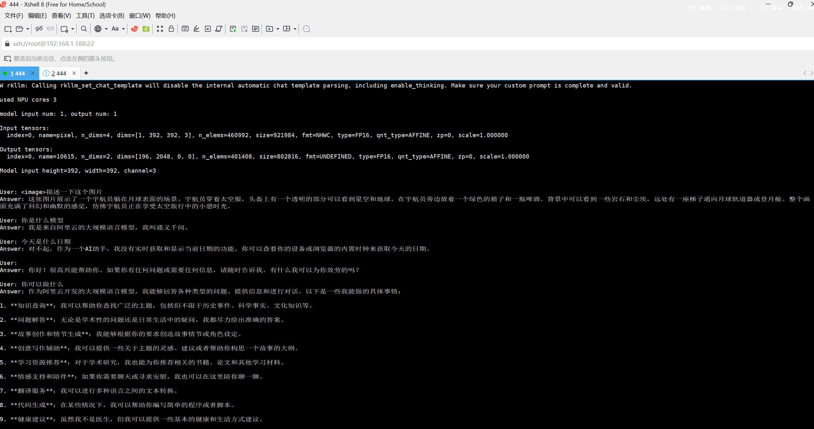

# EdgeVL

在 RK3588 开发板上部署 Qwen2.5-VL-3B 多模态大模型：输入图片和问题，本地 NPU 直接推理出答案。全程离线，数据不出设备。

## 功能

- 图片 + 文字问题 → 模型作答，一条命令跑通
- 模型拆成视觉编码器和语言模型两部分，分别用 FP16 和 W8A8 量化后跑在 NPU 上
- 纯 C++17 实现，推理核心封装成类，方便复用
- 部署过程中解决了交叉编译、动态库、大文件传输等一堆实际问题

## 效果



板子上跑起来后，用 `<image>` 标签开头提问，模型会根据图片内容回答：

```
User: <image>
      描述一下这张图片
AI  : 图中是一轮满月，悬挂在夜空中……
```

## 技术方案

```
图片输入 → 视觉编码器(ViT, RKNN/FP16) → 语言模型(RKLLM/W8A8) → 文本回答
               （全部在 RK3588 NPU 本地推理）
```

Qwen2.5-VL-3B 拆成两段：视觉部分用 FP16 精度转成 NPU 格式（RKNN），语言部分做 W8A8 量化后走 RKLLM 运行时。

## 编译运行

环境：
- RK3588 开发板（Buildroot）
- `aarch64-linux-gnu-g++` 交叉编译器
- rknpu 驱动 + rkllm-runtime

交叉编译：

```bash
aarch64-linux-gnu-g++ -std=c++17 -O3 \
  -I include -I /usr/include/opencv4 \
  src/main.cpp src/RK35llm.cpp \
  ./lib/libopencv_core.so ./lib/libopencv_imgcodecs.so ./lib/libopencv_imgproc.so \
  ./lib/libpng16.so.16 ./lib/libz.so.1 \
  ./lib/librknnrt.so ./lib/librkllmrt.so \
  ./lib/libgomp.so.1 \
  -ldl -lpthread \
  -o VLM_NPU_stb
aarch64-linux-gnu-strip VLM_NPU_stb
```

板端运行：

```bash
./run_board.sh              # 默认测试图片
./run_board.sh /root/xxx.jpg  # 指定图片
```

提问时，图片相关问题以 `<image>` 标签开头。

## 几个关键点

1. **模型量化**：语言模型做 W8A8 对称量化（权重和激活都压到 8bit），视觉编码器保留 FP16，避免量化损失影响图像理解。
2. **NPU 推理**：模型完整跑在 NPU 上，模型文件放板子本地，绕开 NFS 读大文件卡死的问题。
3. **读图**：板子上的 OpenCV 没有 JPEG 解码器，`cv::imread` 用不了，改用 header-only 的 stb_image，零依赖。
4. **传模型**：2GB+ 的文件 NFS/SCP 直传容易断，拆成 200MB 分块传再合并。

## 踩坑记录

| 问题 | 原因 | 解决 |
|------|------|------|
| `rkllm init` 卡死不响应 | NFS 读大文件进内核不可中断等待 | 模型放板子本地 |
| 传大文件 Connection reset | 板子网络大流量不稳定 | 200MB 分块传输 |
| `!_src.empty()` in cvtColor | OpenCV 缺 libjpeg | stb_image 替代 |
| `invalid rkllm model` | 模型下载中断损坏 | 重新下载并校验大小 |
| shared libraries 加载报错 | LD_LIBRARY_PATH 顺序不对 | 运行时库放最前 |

## 目录结构

```
EdgeVL/
├── VLM_NPU_stb            # 编译产物（ARM64）
├── CMakeLists.txt
├── build.sh               # 交叉编译脚本
├── run_board.sh           # 板端运行脚本
├── src/                   # main.cpp / RK35llm.cpp / capture.cpp
├── include/               # 头文件
├── lib/                   # 板端运行时 .so
├── models/                # 模型文件（太大，没进仓库）
├── images/                # 测试图片
└── docs/                  # 开发文档
```

模型文件约 4.9GB，没进仓库，下载说明见 `docs/`。

## 许可证

[MIT](LICENSE)
